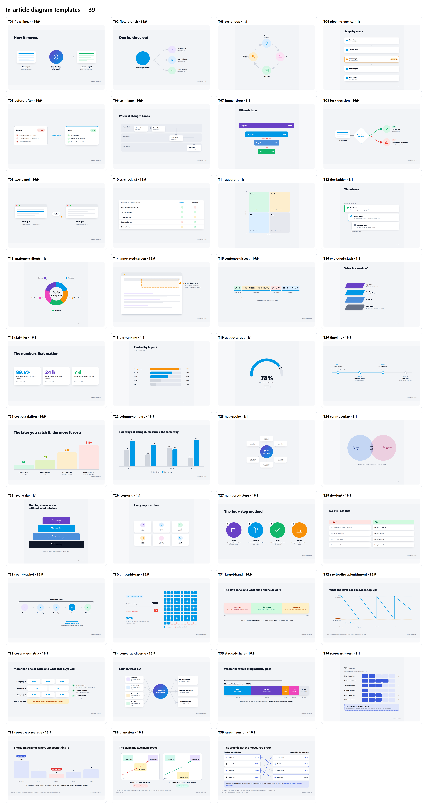

# Blog Diagram Kit

Turn a blog article into **up to five clean, on-brand explainer diagrams**, plus a placement file
that tells your editor exactly where each one goes.

It's built to be driven by [Claude Code](https://claude.com/claude-code): you hand it an article,
it picks the ideas worth drawing, builds the images from a library of 39 tested templates in your
brand, renders them, checks them, and writes the placement instructions.



## What you get per article

| File | What it is |
|---|---|
| `01-<scene>.png` … `05-<scene>.png` | The images, 2× resolution, 16:9 (2400×1350) or 1:1 (2000×2000) |
| `01-<scene>.html` … | The editable source of each image. Change a word, re-render. |
| `PLACEMENT.md` | For each image: the exact H2, the sentence it goes after and before, a one-line transition to paste above it, alt text, and a rule check |

Every image is one idea, readable in about two seconds, in your fonts and colours, with your
domain in the bottom-right corner.

## Requirements

- **[Claude Code](https://claude.com/claude-code)**: desktop app, CLI, or VS Code extension
- **PowerShell**: built into Windows. On macOS/Linux install PowerShell 7 (`brew install powershell`, run scripts with `pwsh`)
- **Microsoft Edge or Google Chrome**, found automatically. Set `DIAGRAM_BROWSER` to a full path to override.

The workflow was built and tested on Windows. The scripts are written to work on macOS/Linux too.

## Getting started (about an hour, once)

1. **Get the repo.**
   ```bash
   git clone https://github.com/<owner>/<repo>.git
   cd <repo>
   ```
2. **Open the folder in Claude Code** and say:
   > Onboard my brand: https://www.yoursite.com

   Claude follows [`_system/ONBOARDING.md`](_system/ONBOARDING.md) with you:
   - asks for your **copy rules** (banned words, whether product claims, pricing or case studies may
     appear on images, how competitors may be named) and saves them to `<Brand>/STYLE-RULES.md`;
   - scans your site for fonts and colours, then confirms the real primary colour with you;
   - asks whether the diagrams sit on a **light or dark** page;
   - writes `<Brand>/brand.css`, renders two test images, and shows you;
   - seeds `<Brand>/USED-TEMPLATES.md`, the ledger that stops two articles drawing the same idea.
3. **Approve the test render.** This is the moment to say "too bright", "headline too heavy" or
   "wrong blue". Fixes go into `brand.css` once and apply to every future image.
4. **Run your first article end to end** (next section) and review it before doing a batch.

Prefer to do it by hand? Every step is written out in [`_system/ONBOARDING.md`](_system/ONBOARDING.md).

## Making images for an article

In Claude Code:

> Make diagrams for https://www.yoursite.com/blog/your-article

Not published yet? Save the text as `<Brand>/<article-slug>/source.md` and say:

> Make diagrams for the draft in `<Brand>/<article-slug>/source.md`

Claude then:

1. maps where an image is **allowed** to go ([placement rules](_system/PLACEMENT-RULES.md): only
   between two body paragraphs, never touching a heading, table, list or CTA, one per section);
2. picks up to five ideas by what each paragraph *argues*, and matches each to a template;
3. builds the images in your brand with the article's real facts, and checks them against your style rules;
4. renders them and reviews one contact sheet (`_review.png`) for layout problems;
5. writes `PLACEMENT.md` and updates the ledger.

If an article can't host five images without breaking the placement rules, you get fewer, and
`PLACEMENT.md` explains which sections were skipped and why. An honest four beats a fifth image
jammed against a table.

**Want a change?** Say it in plain words ("make 03 square", "drop the subtitle on 02", "use our
green for the good path"). Changes that apply to every image go into `brand.css` or the template,
not one file.

## Rendering by hand

```powershell
.\_system\render.ps1 -Path ".\<Brand>\<article-slug>" -Force   # HTML -> PNG
.\_system\review.ps1 -Path ".\<Brand>\<article-slug>"          # one contact sheet for QA
.\_system\brand-scan.ps1 -Url "https://www.yoursite.com/"      # fonts + colours off a live site
```

Always pass `-Force` after editing: without it, images that already have a PNG are skipped.

## How it's organised

```
CLAUDE.md                  the operating manual Claude Code reads automatically
_system/                   the engine: CSS, scripts, rules, onboarding, gotchas
_templates/                39 diagram templates + gallery
<Brand>/                   created when you onboard (your brand file, rules, ledger, articles)
```

| Doc | Read it when |
|---|---|
| [`_system/ONBOARDING.md`](_system/ONBOARDING.md) | setting up your brand |
| [`_system/TEMPLATE-LIBRARY.md`](_system/TEMPLATE-LIBRARY.md) | choosing a shape: the question each template answers |
| [`_system/PLACEMENT-RULES.md`](_system/PLACEMENT-RULES.md) | you want to know why an image went where it did |
| [`_system/GOTCHAS.md`](_system/GOTCHAS.md) | editing images by hand: the silent CSS traps |

## House style, in short

- 16:9 or 1:1 only. One idea per image. 2–6 objects. Readable in two seconds.
- Three type sizes and three text colours per image, maximum.
- No text on connector lines; arrows point at the centre of what they hit.
- Brand tokens only, with no stray hex values. Flat: no 3-D, no clip art, one gradient element at most.
- **Real numbers or none.** Every figure comes from the article and names its source on the image.
- No software listicles ("Best N tools…"): guides, how-tos and explainers only.
